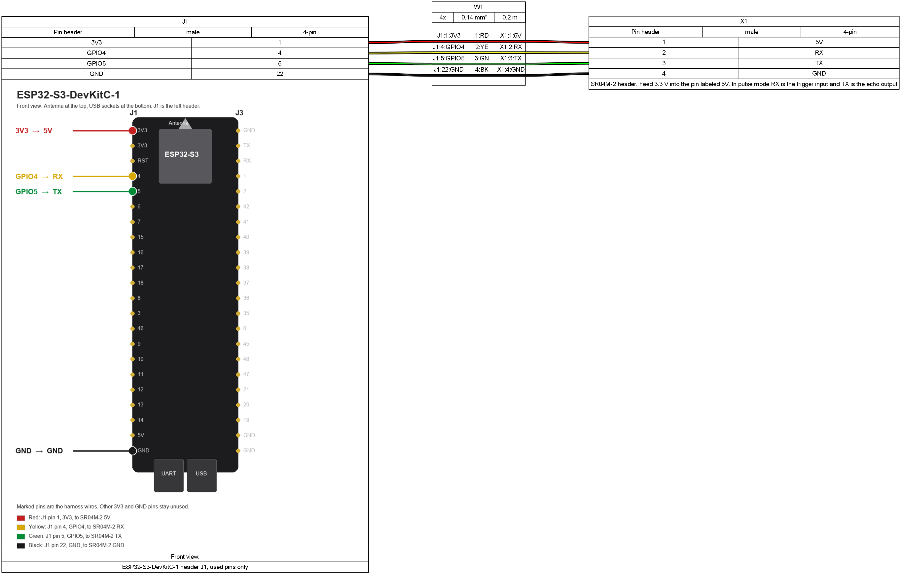

# ESP32-S3 DevKitC-1

This page is the wiring and build for the `esp32-s3` environment in `platformio.ini`. MQTT, settings, and the status LED colors are in the [main README](../README.md).

## Hardware

* [ESP32-S3-DevKitC-1](https://docs.espressif.com/projects/esp-dev-kits/en/latest/esp32s3/esp32-s3-devkitc-1/user_guide_v1.1.html)
* SR04M-2 waterproof ultrasonic module (JSN-SR04M-2, the same family as the AJ-SR04M)
* Four Dupont jumpers, 0.14 mm², about 0.2 m

USB powers the DevKit. The module takes 3.3 V from that board. Its supply range is 3.0–5.5 V and its working current is under 8 mA, so the DevKit regulator is enough. The supply pin is labeled `5V`. Fed at 3.3 V, the echo output stays at 3.3 V, so no divider is needed.

Leave R19 open. The firmware sends a 20 µs trigger pulse, which is mode 1 of this module. The 300 kΩ powersave resistor in the main README belongs to the battery build.

GPIO26 is not on the DevKitC-1 headers. It stays inside the module for the flash. The S3 build moves the trigger to GPIO4 with `-DTRIG_PIN=4` in `platformio.ini`. Echo stays on GPIO5. The `esp-wroom-32` build keeps GPIO26.

## Wiring

J1 pin numbers follow the [Espressif v1.1 user guide](https://docs.espressif.com/projects/esp-dev-kits/en/latest/esp32s3/esp32-s3-devkitc-1/user_guide_v1.1.html): antenna at the top, USB sockets at the bottom, J1 on the left. The harness drawing shows the front view under the ESP32 pin table, with the four wires marked in the cable colors.

The SR04M-2 header is labeled `5V`, `RX`, `TX`, `GND`. In this pulse mode, `RX` is the trigger input and `TX` is the echo output.

| DevKit J1 | Signal | Color | SR04M-2 |
|---|---|---|---|
| Pin 1 | 3V3 | Red | 5V |
| Pin 4 | GPIO4, trigger | Yellow | RX |
| Pin 5 | GPIO5, echo | Green | TX |
| Pin 22 | GND | Black | GND |



The on-board RGB LED is not part of this harness. Early DevKitC-1 boards use GPIO48 for it, newer ones use GPIO38. The colors are listed in the main README.

## Build

`pio run` without an environment still builds `esp-wroom-32`. For this board:

```
pio run -e esp32-s3
pio run -t upload -e esp32-s3
```

Copy `include/settings.h.example` to `include/settings.h` and fill it in as described in the main README.
